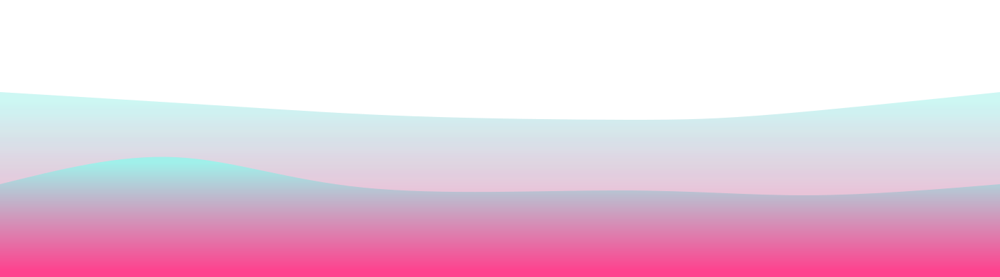

  

  

  

    
    
    
    
  

  

---

## About Me

I am Nitkarsh Chourasia, a developer who likes turning curiosity into working software. I learn by building: small tools, experiments, automation scripts, backend projects, language practice repositories, and notes that make difficult topics easier to revisit.

- Currently exploring Rust, compilers, toy databases, peer-to-peer transfer, and backend fundamentals.
- Building with Python, JavaScript, C/C++, C#, Java, notebooks, and practical AI/document workflows.
- Interested in automation, full-stack development, data-heavy tools, open-source learning, and clean project documentation.
- Operating principle: be pragmatic, ship working systems, then improve them with evidence.

## Featured Work

<table>
  <tr>
    <td width="50%">
      
    </td>
    <td width="50%">
      
    </td>
  </tr>
  <tr>
    <td width="50%">
      
    </td>
    <td width="50%">
      
    </td>
  </tr>
  <tr>
    <td width="50%">
      
    </td>
    <td width="50%">
      
    </td>
  </tr>
</table>

## What I Build

| Area | Current Direction |
| --- | --- |
| Backend and automation | Python scripts, Flask/Django learning, Node.js, API-shaped utilities, and repeatable workflows |
| Systems learning | Rust practice, compiler notes, toy database ideas, file transfer experiments, and lower-level engineering fundamentals |
| Data and AI | Jupyter/Colab notebooks, OCR/document ideas, ML practice, prompt engineering, and practical tooling |
| Programming foundations | DSA, language practice, puzzle repositories, C/C++, C#, Java, and JavaScript fundamentals |
| Creative technology | Web portfolios, video/audio/image tooling, presentations, spreadsheets, and documentation |

## Toolbox

  

 

  
  
  
  
  
  

## GitHub Snapshot

  
  
   
  
   
  

  
More places to find me

   

  [Facebook](https://www.facebook.com/nitkarsh.chourasia.3/) |
  [Instagram](https://www.instagram.com/nitkarsh.chourasia/) |
  [Pinterest](https://pinterest.com/NitkarshChourasia/) |
  [Quora](https://www.quora.com/profile/Nitkarsh-Chourasia-1) |
  [Reddit](https://www.reddit.com/user/NitkarshC) |
  [X/Twitter](https://twitter.com/NitkarshC) |
  [YouTube](https://www.youtube.com/channel/UCjZbPEyOT2M44rN4lq98kNQ)

  
Holopin badges

   

  

 

  
  
<strong>Being pragmatic is the way.</strong>

